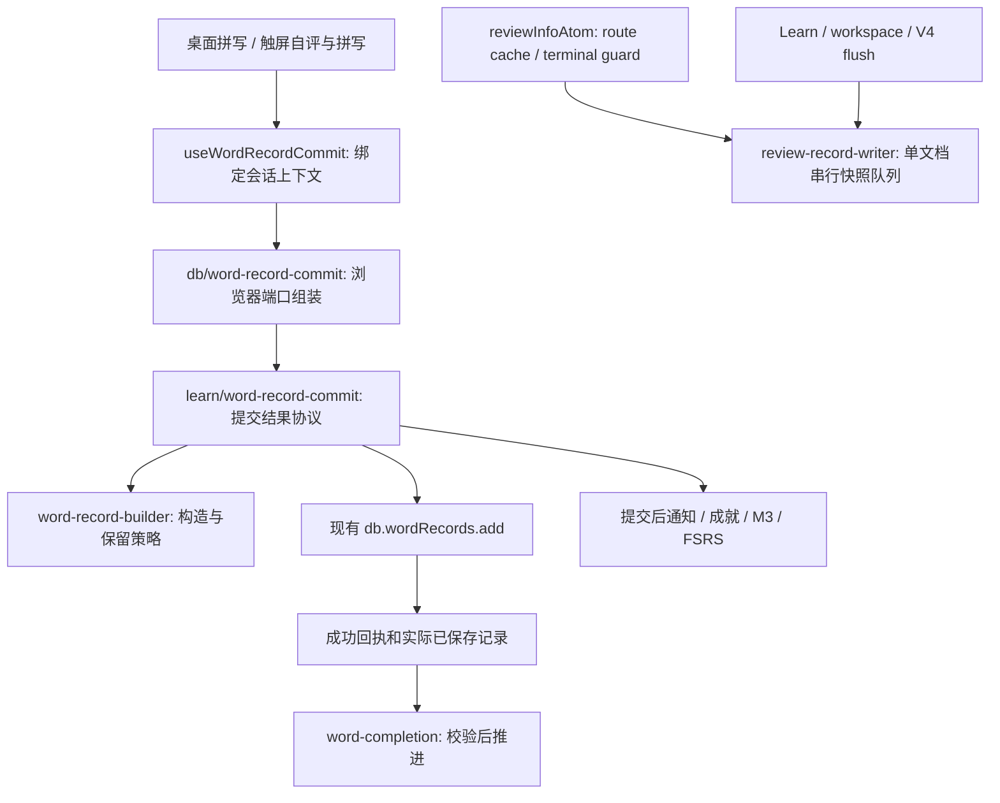

# 学习记录提交接口

阶段 2b 的局部模块契约。适用于新作答提交，不替代既有导入、迁移、云同步或工作区恢复协议。

## 原始记录提交

- `WordRecordInput` 是练习冻结的观测和评分，不让提交服务重算 evidence。桌面拼写、自评、客观拼写和 acquisition/review 保持各自语义。
- `WordRecordContext` 由 React 适配器绑定词书、章节、会话终态及追踪信息。服务首先拒绝已结束 Learn 会话，之后调用构造端口和唯一的 raw `add` 端口。
- `buildWordRecord` 继续使用原 `WordRecord`、时钟、CSPRNG attemptId 和 Typing retention。没有数据库升级或旧记录重写。
- `WordRecordCommitResult` 是 `rejected(session-finished)`、`failed(prepare/write)` 或 `saved`。成功与失败不再使用同一个数字 sentinel 表达。
- `saved.receipt` 是仅由服务创建的不透明 TypeScript 类型，包含有效 ID、原 attemptId 和实际已保存记录。UI 从回执读取结果，不自行给观测对象填 ID。它是内部类型约束，不是安全令牌；不能替代身份/所有权/工作区保护。
- `effects` 总是完成为逐项结果列表；单个副作用可以失败，原始提交仍是 saved。服务在返回 saved 前启动全部副作用，确保 FSRS 待保存注册发生在完成/flush 前；不等待慢副作用才放行界面。`fulfilled` 只表示该端口调用完成，不表示账号云端收敛。
- 调用者不能因副作用失败再次写原始记录。显式原始保存重试仍由当前练习控制；离开页面不撤销已启动的事务，旧 UI 回调不得推进新页面。成就、M3 和 FSRS 保留现有扫描/重建路径。

## 完成与内存恢复

`WordFinishResult` 位于应用层，Learn 分支必须携带回执，普通 Typing 分支保留原失败推进行为。WordPanel 在改变任何队列/结算状态前用 `assertLearnCompletion` 校验回执、记录和当前词书/单词/attemptId。触屏草稿只在同一文档的内存里保存回执；整页重载仍从持久记录和既有恢复流程重建，不把回执写入 localStorage、备份或云端。

## ReviewRecord 队列

`utils/db/review-record-writer.ts` 是文档内唯一 writer 实例。`reviewInfoAtom` 负责请求写入，所有 Learn/workspace/V4/recovery flush 消费者直接导入该 writer，不通过 store 导出。

队列继续复用 `createSerializedSnapshotWriter`：入队时复制快照，按调用次序执行；flush 返回当时队尾结果。写入失败会被日志观察，但原始 Promise 和 flush 仍拒绝。显式后续快照可按原语义继续执行。没有改变事务、锁、journal 或恢复步骤。

## 验证入口

- `tests/learn/word-record-commit.test.mjs`：拒绝/失败/已保存、构造字段、并发隔离、副作用独立。
- `tests/learn/word-completion-types.test.mjs`：UI 不能直接构造回执、无回执不能构造 Learn 完成结果。
- `tests/learn/review-record-writer.test.mjs`：共享队列、不可变快照、顺序、flush 和失败传播。
- `tests/learn/persistence-architecture.test.mjs`：无 Learn→store 豁免及已修复环边的反例。
- `tests/e2e/learn-save-failure.spec.ts`：真实页面失败停止、事务 abort、最后一词、重试、卸载、派生失败、触屏草稿返回。

不在本阶段处理：BootOutcome、云服务大模块、全仓类型基线、历史 gate manifest 和其他文档过时条目。见分阶段任务计划。
