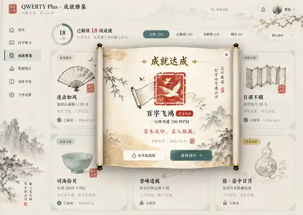

# QWERTY Plus · 宋韵成就雅集｜视觉设计文档集

> 建立日期：2026-10-16。研究分支：`design/achievement-song-aesthetic-20261016`  
> **批准的方向是：图片母版优先 + 动态文本、印章和云雾层合成动画。** 旧的简易 SVG/CSS 展示仅是技术原型，不代表美术验收成功。
>
> **修改范围**：现有 Focus UI 的 **成就弹出系统内部**，不改 Focus UI 主体布局、不把站点重构成宋代风格全屏网页。  
> **生产主线未变**：`product/main`、`edgeone-test`、`master` 均不从该文档自动升级或发布。

## 文档目录

1. [视觉架构 v1](./architecture/Achievement-Visual-Architecture-v1.md) — 图像优先分层方案、三档稀有材质、未解锁云雾微露、隐藏信息保密、Focus 入境明暗双主题、展卷与压印仪式、业务和无障碍约束、保留原始需求全文。
2. [图片资产清单 v1](./assets/Achievement-Asset-Manifest-v1.md) — 真实 P0 **19 个成就**，逐一列出候选器物、视觉稀有度、锁定形态、制作优先级，定义按成就 ID 命名的场景图/器物/印章/云雾/卷轴与 manifest 校验。
3. [「百词基石」精修制作单 v1](./production/Hundred-Words-Masterpiece-v1.md) — 汝窑青瓷莲花碗、宣纸宋锦、专属朱砂印的图像生产规格，明确画面文本安全区、真正压印时序、UI 合成和人工验收。
4. [目标概念图与视觉对照](./references/README.md) — 在 Git 中归档的、确实存在的目标图 WebP 压缩参考版。用于视觉质量与构图对比，不当作线上美术资源。

## 入库目标图

**注：** Git 当前保存的是由用户提供的目标概念图降采样后的 **600×425 有损 WebP**，不是原始 1491×1055 无损截图；要保留印泥和宋锦的细节仍应在后续补全高保真母版。此处对照是完整美术方向，而非“纯 SVG 重制图”的质量声明。

## 原则与推进门槛

- Focus UI 继续是学习产品原有的干净界面；仅在成就弹窗中自然“入境”。
- 成就已经解锁后有朱砂实印、日期题跋；未解锁有图片雾层隐约微露；隐藏成就不得泄密。
- 明/暗主题分别出图和转场，不用 invert 滤镜。
- 先验收**百词基石**一件精品，达到目标概念图级别，再批量制作其他 P0 资产。
- CI、GitHub Pages 演示和当前研究用 CSS/SVG 版本，不自动等同于视觉质量通过。
- 更改实际成就列表或数据处理协议不是这组文档的任务。继续保持既有稀缺发奖机制和业务 Gate。

## 参考资料

- [初代 SVG/CSS 技术实验记录](../Song-Achievement-Collection-v1.md) — 仅保留为历史，不作为新图片主方案。
- [真实成就定义](../../../src/resources/achievementCulture/achievements.json)
- [成就稀缺性与发放节奏](../../ACHIEVEMENT_DIFFICULTY_PACING_V1.md)
